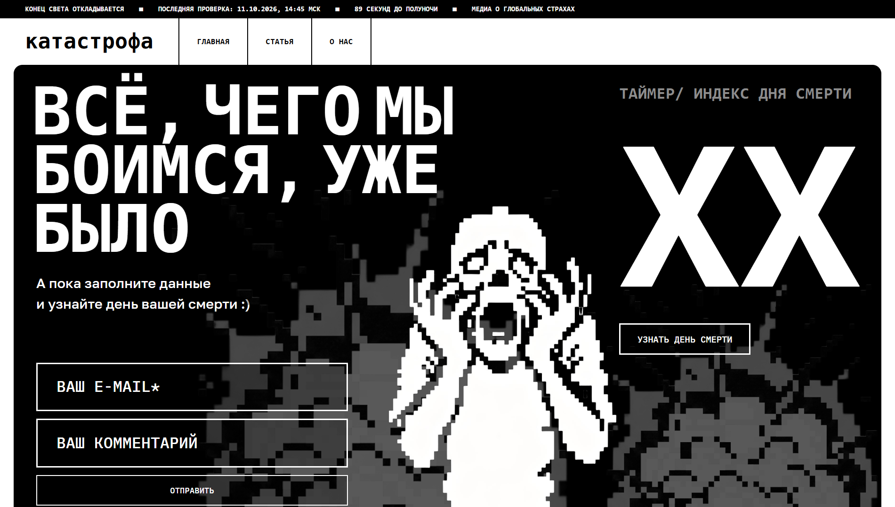
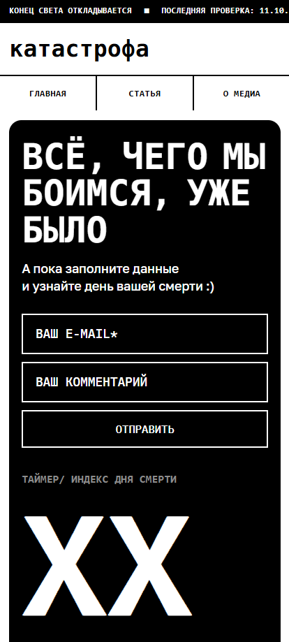

# [КАТАСТРОФА]

[Исследовательское медиа о глобальных страхах и их отражении в культуре]

## Ссылки

- Сайт: [https://hseadc.github.io/the-end/]
- Макет в Figma: [(https://www.figma.com/design/RLyTG3nGPNqyWY0MirIckY/the-end-case?node-id=0-1&t=vuRGkbjNPrfoCYtJ-1)]

## Скриншоты

 

## Команда

| Участник  | Что делал(а)                              |
| --------- | ----------------------------------------- |
| [Валерия] | [исследование, фир.стиль, верстка, код]   |
| [Мария]   | [исследование, расшифровка, дизайн, мерч] |

## Стек

- [npm и 11.19.0]
- [node js и v24.20.0]

## Как запустить локально

```bash
git clone [git@github.com:HSEADC/the-end.git]
cd [the-end]
npm install
npm run dev
```

## Структура проекта

```
src/
├── fonts/                  # Шрифты проекта
├── images/                 # Изображения проекта
├── javascript/             # JavaScript-файлы
├── pages/                  # Страницы сайта
│   ├── articles/           # Страницы отдельных статей
│   ├── about.html          # Страница о проекте
│   ├── articles.html       # Список статей
├── stylesheets/            # CSS-стили
│   ├── adaptive.css        # Адаптивная вёрстка
│   ├── animation.css       # Анимации
│   ├── fonts.css           # Подключение шрифтов
│   ├── layout.css            # Стили главной страницы
│   ├── reset.css           # Сброс стандартных стилей
│   └── style.css           # Дополнительные стили
└── index.html              # Главная страница сайта

```

## Решения и сложности

- [Валерия]
  Сложнее всего было, наверно, собирать исследование, так как я впервые делала его так масштабно и полноценно. Найти, а после опросить 20+ человек было испытанием, с которым мне и Маше предстояло столкнуться. Далее, уже после интервью и сбора информации, следующей трудностью было собрать несколько общих данных и на их основе составить опрос. У людей различного поколения имеются свои индивидуальные представления о теме нашего проекта: это и плюс, и минус одновременно. Чаще всего люди говорят о грядущих проблемах, которые способны привести к "концу света". Поэтому более глобализированную информацию нужно собирать в источниках европейского масштаба.
- [Мария]
  Большой сложностью и "болью" для меня оказалось исследование и поиск стиля медиа. Мы с Лерой потратили большую часть энергии и времени, изучая особенности мышления людей в образах страхов, конца света и глобализированных проблем. Далее нужно было нащупать образ и символ, за который можно зацепиться и чтобы он был понятен обычным людям, не превращая медиа в слишком локальную историю.

## Использование ИИ

### Инструменты

| Инструмент и модель | Кто    | Для каких задач                                  | Уровень (0–4) |
| ------------------- | ------ | ------------------------------------------------ | ------------- |
| [Claude Opus 5.5]   | [Лера] | [код в script.js, adaptive.css]                  | [3]           |
| [Claude Opus 5.5]   | [Маша] | [вёрстка разделов about и footer, adaptive.css]  | [2]           |
| [ChatGPT]           | [Лера] | [помощь в оформлении и поиске ошибок layout.css] | [1]           |

### Журнал запросов

[Записи по формату ниже или ссылка: подробный журнал — в docs/ai-log.md]

#### #1 · [25.10.2026] · [Лера]

- **Инструмент:** [ChatGPT]
- **Задача:** [Объяснение написания стилей в layout.css и функций в script.js, решение проблемы с vite.config]
- **Запрос:** [> b25ds10@2.0.0 build
  > vite build
  > failed to load config from /home/runner/work/the-end/the-end/vite.config.js
  > error during build:
  > ReferenceError: root is not defined
      at file:///home/runner/work/the-end/the-end/node_modules/.vite-temp/vite.config.js.timestamp-1792888089198-c1d93d231a23.mjs:43:3
      at loadConfigFromFile (file:///home/runner/work/the-end/the-end/node_modules/vite/dist/node/chunks/dep-Dm0c1Wj2.js:49398:64)
      at async resolveConfig (file:///home/runner/work/the-end/the-end/node_modules/vite/dist/node/chunks/dep-Dm0c1Wj2.js:48891:24)
      at async createBuilder (file:///home/runner/work/the-end/the-end/node_modules/vite/dist/node/chunks/dep-Dm0c1Wj2.js:46866:18)
      at async CAC.<anonymous> (file:///home/runner/work/the-end/the-end/node_modules/vite/dist/node/cli.js:862:23)
  Error: Process completed with exit code 1.

В чём проблема и ошибка? У меня не работает gitActions]

- **Что выдал ИИ:** [Проблема в файле vite.config.js: во время сборки Vite пытается использовать переменную root, но она не объявлена или недоступна в текущей области видимости. Поэтому GitHub Actions останавливает сборку с ошибкой exit code 1.

Это означает, что ошибка возникает ещё при чтении конфигурации Vite, до самой сборки проекта.

Возможные причины:

- Переменная root используется без объявления.
- Ты хотел использовать root как параметр конфигурации Vite, но забыл его определить.
- Переменная была объявлена внутри другой функции или блока и недоступна в месте использования.
- После изменения vite.config.js осталось обращение к старой переменной.

2. Как исправить
   Открой файл vite.config.js и найди строку, где используется root. По логу это примерно 43-я строка временного файла конфигурации.]

- **Что изменили и почему:** [ Что изменено
- outDir теперь строится через root, чтобы пути были согласованы.
- base: './' используется для относительных путей к ресурсам, что часто удобно для публикации через GitHub Pages.
- Форматирование плагина упрощено; логика выбора скриптов сохранена.
  Важный нюанс: base: './' подходит не для всех конфигураций GitHub Pages. Если сайт публикуется по адресу вида https://username.github.io/the-end/, обычно лучше указать base: '/the-end/', где the-end — название репозитория. Если сайт публикуется в корне домена, можно использовать '/'.]
- **Итог и проверка:** [Прописала команду npm run build в GitBush и переписала import в vite.config / // _________________поменяла Import_________________]

#### #2 · [26.10.2026] · [Лера]

- **Инструмент:** [Claude Opus 5.5]
- **Задача:** [ Сделать базу адатптива для дальнейшей проверки и правок в структуре]
- **Запрос:** [ Сделай резиновый адаптив этого кода на телефон]
- **Что выдал ИИ:** [ Написал мобильный адаптив (до 768px) для хедера, главной, статьи и «О нас». Заменить нужно два файла в src/stylesheets/: adaptive.css и style.css. Проверить в браузере я не мог, так что смотри на реальном телефоне или в режиме устройства в DevTools.

Почему старый адаптив не работал

В style.css adaptive.css подключался раньше layout.css. У правил там одинаковая сила, и побеждает то, что ниже по файлу, поэтому десктопные значения перебивали мобильные. Теперь adaptive.css подключён последним.
body { height: 100vw } и фиксированные высоты в vw на телефоне ломали вёрстку, я их сбросил.
Рамки в 0.2vw на телефоне получались тоньше пикселя, теперь везде 2px.

Как устроен адаптив

Твой приём сохранён: 1rem = 1px на ширине 390px, всё остальное тянется пропорционально. Все размеры в мобильной версии написаны в rem.
Хедер: бегущая строка листается пальцем, логотип сверху, меню на всю ширину.
Главная: блок идёт в колонку, картинки с absolute прижаты к низу чёрного блока.
Статья: картинки перешли из absolute в обычный поток. Три нижних идут в ряд через grid, их порядок задан через order.
«О нас»: у .panel сброшена высота и ширина (старый адаптив их не трогал), авторы и кнопки идут в столбик.
Hover-эффекты (зелёные полоски и gaitiGreen, zombieGreen) на телефоне скрыты, на тач-экране они не нужны.

Что проверить

В архиве нет index.html. Я опирался на классы из CSS и два скриншота, где виден только главный экран. Я предположил, что картинки .mainImg\_\* лежат внутри .main, а .gaitiImg, .zombie_1, .scince и .zombie_2 лежат прямо в .article. Если что-то уехало, пришли index.html, и я подгоню.
В index.html должен быть тег <meta name="viewport" content="width=device-width, initial-scale=1.0">. Без него телефон рисует страницу как на 980px, и медиазапрос не срабатывает.

Заодно

В fonts.css шрифт назван IMBPlexMono, а в .header, .numbers и .deathTimeText стоит 'IBM Plex Mono'. В этих местах шрифт не подгружается и берётся системный моноширинный, поэтому ширина текста может отличаться на разных устройствах. Я это не менял.
Страницы articles.html и aloe.html не подключают CSS и используют другие классы, так что адаптировать там пока нечего.]

- **Что изменили и почему:** [Некоторые элементы layout.css, adaptive.css и index.html были незначительно изменены в виду особенностей стилей проекта и структуры]
- **Итог и проверка:** [Проверка проходила через локальный сервер npm run dev / /* ___________________Адаптив написан при помощи Claude Opus 5.5___________________ */]

#### #3 · [26.10.2026] · [Маша]

- **Инструмент:** [Claude Opus 5.5]
- **Задача:** [сделать адаптив для footer]
- **Запрос:** [Now we need to code the footer—keep it simple, without any unnecessary, messy code. For now, don’t add any functionality to the section links when they’re clicked. In the spots designated for Telegram and T-Journal, please add placeholders for the social media icons. I’ll provide the layout;]
- **Что выдал ИИ:** [The footer is ready; the file is named footer.html. It’s a single file containing both the markup and the styles (within a <style> block), with no JavaScript. I’ve tested it in a browser at a width of 1440px (matching the design mockup) and at a mobile width (ensuring nothing overflows the screen).

What’s inside:

The sections (Home, Article, About Us) are links without an href attribute, so clicking them does nothing. You can simply add the actual URLs when needed. The "Home" link is highlighted in green using the is-active class.
There are placeholders for icons—14×14 dashed squares—before the words "Telegram" and "T-Journal" (using the footer\_\_icon class). You can replace these <span> elements with  or <svg> tags. If the icons are meant to replace the arrows (↗️) rather than appear alongside them, let me know, and I’ll make the adjustment.
The Telegram and T-Journal links currently point to #; you’ll need to replace these with the actual URLs. The email link is already set up as a mailto: link.
The logo scales to the width of the screen, and the green bar is adjusted so that the letters "ф" and "р" touch its edges, just as in the mockup.
The "Back to top ↑" link points to #, which simply scrolls the page back to the top.

I’ve used the JetBrains Mono font, which is similar to the one in the mockup. If your site uses a different font, please let me know its name; I’ll need to make a minor adjustment to the height of the green bar—it’s just a single line in the CSS, marked with a comment.]

- **Что изменили и почему:** [были изменены единицы размеров (из px и vh на vw и rem), в adaptive.css были изменены размеры элементов]
- **Итог и проверка:** [index.html, layout.css, adaptive.css были внедрены части данного рздела / /* ______________Футер______________ */]

#### #4 · [26.10.2026] · [Маша]

- **Инструмент:** [Claude Opus 5.5]
- **Задача:** [сделать адаптив для about]
- **Запрос:** [Could you quickly put together an "About Media" screen that matches the style of this project—just make sure it’s not cluttered or packed with a bunch of useless, tiny text.]
- **Что выдал ИИ:** [I’ve built the "О нас" page and the two author pages. At 1440px all three match your mockup to within 1–2px, and the ID card tilts with the mouse. Everything is in about-us.zip.
  What’s inside:
  about.html: "ВЫЖИВШИЕ :" with the two portraits. On hover a portrait gets the green frame and its button turns green, as in the mockup.
  author-riarim.html and author-reznik.html: the ID cards plus two buttons, "Назад к авторам" and "Перейти к другому автору".
  src/stylesheets/about.css: all styles. Layout uses flexbox only, no CSS Grid.
  src/javascripts/tilt.js: the tilt, about 20 lines with const only, no var. It switches off if the visitor has “reduce motion” turned on.
  src/images/: your two cards, plus the two portraits, which I cut out of the cards.
  src/fonts/: IBM Plex Mono for the menu and buttons, IBM Plex Sans Bold for the logo, and Roboto Condensed Bold for the big heading. All are free to use on a website (OFL licence).
  The adaptive part is one block at the bottom of about.css, between /* АДАПТИВ: экраны до 768px */ and /* конец адаптива */. Below 768px the portraits stack, the ID card fills the width and the buttons go full width.
  Things to check:
  Heading font. I couldn’t identify the font of "ВЫЖИВШИЕ :" in your mockup; the square colon dots suggest a Mac system font like Helvetica Neue Condensed, which can’t be shipped with a website. Roboto Condensed Bold is the closest free match. Tell me the font name from Figma and I’ll swap it.
  Logo is plain black text with no highlight, as you asked.
  Tilt is only on the ID cards. To add it to the portraits too, add the class tilt to .author__photo and load tilt.js on about.html.
  Header styles. This header follows the new mockup (no ticker, no search), so its styles are in about.css, not layout.css.]
- **Что изменили и почему:** [Структура кода не была изменена, только присоединение в index.html]
- **Итог и проверка:** [index.html, layout.css, adaptive.css, script.js были внедрены части данного рздела / /* _______________Статья "О проекте"_______________ */]

### Рефлексия

[Лера]

[Мне было очень комфортно и продуктивно работать в команде с Машей. Мы грамотно подошли к исследованию, сбору информации о теме проекта, поиску визуального образа, вёрстке заглушки сайта и рационального использования ИИ в работе. Мы рассматривали более узконаправленные подсказки для зрителя, о чём мог бы быть наш проект, но решили отказаться в пользу доступности и понятности медиа. Мы научились грамотному ведению исследования, сбору информации, комбинированию собственного видения и советов преподавателя. В дальнейшем хотим доразвить визуальный стиль нашего медиа, чтобы он отвечал нуждам людей и служит медиа-библиотекой для коллекционирования историии и культуры, впечатлений и сравнений разных возрастных категорий]

[Маша]

[Мне было очень комфортно и продуктивно работать в команде с Лерой. Скажу так же: мы грамотно подошли к исследованию, сбору информации о теме проекта, поиску визуального образа, вёрстке заглушки сайта и рационального использования ИИ в работе. Мы рассматривали более узконаправленные подсказки для зрителя, о чём мог бы быть наш проект, но решили отказаться в пользу доступности и понятности медиа. Мы научились грамотному ведению исследования, сбору информации, комбинированию собственного видения и советов преподавателя. В дальнейшем хотим доразвить визуальный стиль нашего медиа, чтобы он отвечал нуждам людей и служит медиа-библиотекой для коллекционирования историии и культуры, впечатлений и сравнений разных возрастных категорий]
